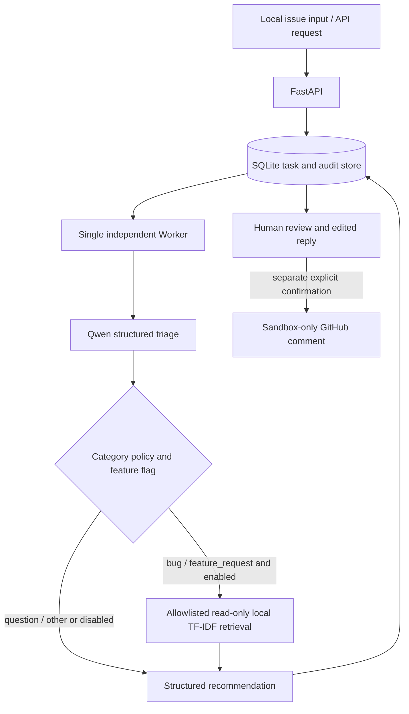

# IssuePilot — 人工审核优先的 GitHub Issue 分诊后端

IssuePilot 解决软件团队对 Issue 进行可追踪分类、优先级建议、相似工单检索和人工复核的问题。FastAPI 只负责接收与查询任务，独立 Worker 调用 Qwen 并用 Pydantic 验证结构化输出，SQLite 保存任务、租约、审计和审批状态。所有成功结果都停在人工审核；可选 GitHub 写回是单独的显式动作，并且代码层面只允许 `WHanY-7/IssuePilot-Sandbox`，审批本身不会写入 GitHub。

公开仓库默认使用 [合成示例数据](data/issues_demo.json)，不包含本地收集的真实 Issue 全文、人工金标、原始模型响应、任务数据库或运行日志。

## Architecture and API

The API creates and reviews tasks but never processes `pending` tasks in-process. The independent Worker polls the shared SQLite database.



The model cannot call arbitrary tools. The optional retrieval branch is an in-process bounded policy: at most one local tool call, five candidates, three flow steps, no network tool, and no automatic duplicate decision.

- `GET /api/health`: service status and whether sandbox writeback is configured (`write_back_enabled` requires the exact sandbox repository plus a non-empty token).
- `GET /api/issues`: inspect local sample issues.
- `POST /api/tasks`: queue one issue. `idempotency_key` makes client retries return the original task instead of creating a duplicate.
- `GET /api/tasks/{task_id}` and `/audit`: inspect state, result, and audit events.
- `POST /api/tasks/{task_id}/review`: approve an explicitly edited reply or reject the result.
- `POST /api/tasks/{task_id}/retry`: manually retry an eligible failed analysis.
- `GET /api/tasks/{task_id}/github-preview`: preview and hash a sandbox comment without writing it.
- `POST /api/tasks/{task_id}/github-sync`: perform an explicitly confirmed, one-time sandbox writeback.

Interactive API documentation is available at `http://127.0.0.1:8790/docs` in Windows local mode and `http://127.0.0.1:8791/docs` in the default Compose deployment.

Task flow is `pending -> running -> needs_review -> approved|rejected`. Worker/model errors and expired leases produce `failed`. A retry is manual and returns `failed -> pending`; at most two total analysis attempts are allowed. Workers hold renewable leases, and results from a wrong or expired lease owner are discarded. API restarts preserve queued tasks.

## Setup and startup (Windows PowerShell)

1. Create Python 3.12 virtual environment: `py -3.12 -m venv .venv`.
2. Install dependencies: `.\.venv\Scripts\python.exe -m pip install -r requirements.txt`.
3. Copy the safe template: `Copy-Item .env.example .env`, then set your own `ISSUEPILOT_AUTH_SECRET` and `QWEN_API_KEY`. Never commit `.env`.
4. Start the API with `.\.venv\Scripts\python.exe -m uvicorn issuepilot.api:app --host 127.0.0.1 --port 8790`.
5. In a second terminal, explicitly start the Worker when pending tasks should be processed: `.\.venv\Scripts\python.exe -m issuepilot.worker --poll-seconds 3`.

Key environment variables:

| Variable | Purpose | Default / safety behavior |
|---|---|---|
| `ISSUEPILOT_AUTH_SECRET` | Local Bearer secret, minimum 20 characters | Required by protected API routes |
| `ISSUEPILOT_DATASET` | Local candidate dataset | `data/issues_demo.json` |
| `ISSUEPILOT_DB` | SQLite task database | `data/tasks.sqlite3` (ignored by Git) |
| `QWEN_API_KEY` | Real Qwen calls from Worker | No usable default |
| `QWEN_MODEL` | Qwen model name | `qwen3.8-flash` |
| `ISSUEPILOT_SIMILARITY_ENABLED` | Optional local retrieval enrichment | `false` |
| `ISSUEPILOT_GITHUB_TEST_REPO` | Writeback repository | Must equal `WHanY-7/IssuePilot-Sandbox` |
| `ISSUEPILOT_GITHUB_TOKEN` | Narrowly scoped sandbox token | Empty/disabled |

The Worker performs analysis only and never writes to GitHub. `bootstrap_windows.ps1` provisions/checks the environment, runs mocked tests, and starts only the API; it intentionally does not start the Worker. The bootstrap script may install dependencies, so it is not needed for routine startup.

## Human review and sandbox writeback

Approval requires reviewer identity, a meaningful reason, and an explicitly reviewed reply. The approved reply is frozen in SQLite; the audit log stores its SHA-256 rather than duplicating the text. Rejection cannot contain publishable reply text.

Sandbox writeback is disabled unless `ISSUEPILOT_GITHUB_TEST_REPO=WHanY-7/IssuePilot-Sandbox` and a narrowly scoped local `ISSUEPILOT_GITHUB_TOKEN` are both configured. The destination is hard-coded and checked before network access. Sync requires an approved task, meaningful review metadata, a current preview hash, and `WRITE_TO_ISSUEPILOT_SANDBOX`. SQLite permits only one claim per task. Uncertain POST outcomes require manual reconciliation and are not automatically retried.

## Local tests (no paid API or external write)

Run `.\.venv\Scripts\python.exe -m unittest discover -s tests -v`. Tests use a temporary SQLite database, mocked model output, and mocked GitHub calls. They disable `.env` loading so local credentials are not read.

## Offline triage-quality evaluation

The independent `evaluation.triage_quality` module can build a private human-labeling template from `data/issues_demo.json` and evaluate separately saved predictions without importing the API/Worker or calling external services. Generated annotations belong under ignored `evaluation/generated/`; the public release does not include real human gold labels or raw prediction runs.

Annotation instructions and the P0-P3 rubric are in `evaluation/README.md`. Once independent human labels and real saved predictions exist, the evaluator writes JSON and CSV comparisons, category Accuracy/Macro-F1, priority consistency, coverage, system task success, and typed error counts. When gold labels or predictions are absent, metric values remain null with an explicit `NOT_COMPUTABLE` status. Synthetic demo data is suitable for workflow validation, not performance claims.

## Optional similar-issue retrieval

IssuePilot can enrich a completed triage result with evidence from similar public Issues in the local candidate corpus. This addresses a practical review question—“has a closely related report already been filed?”—without treating text similarity as proof of duplication.

The public first-stage corpus is the four synthetic records in `data/issues_demo.json`. Retrieval is deterministic, read-only TF-IDF cosine ranking over title and body text. It excludes the current Issue, returns at most five unique candidates, and copies each candidate URL from the validated local record. `retrieval_score` is only a ranking score; it is not a duplicate probability. `suspected_duplicate` remains a recommendation that requires human review, never an automatic close, merge, comment, or label change.

The enhanced path is a bounded three-step state flow:

1. Run the existing structured triage once.
2. Apply the explicit category policy. `bug` and `feature_request` may search; `question` and `other` skip it.
3. Call the single allowlisted local retrieval tool at most once, then attach `similarity_analysis` to the triage JSON.

There is no tool loop or automatic retry. The local tool accepts only the current Issue record and a `top_k` capped at five; it cannot execute commands, choose arbitrary files, access the network, or invent candidate URLs. A timeout or corpus-validation failure produces an explainable `error` result with `insufficient_evidence`. All external writeback still requires the existing explicit human approval and sandbox safeguards.

The feature is disabled by default. Basic mode therefore retains the original `TriageResult` structure and behavior. To opt in for a Worker process, set this placeholder in that process's environment and restart only that Worker when appropriate:

```env
ISSUEPILOT_SIMILARITY_ENABLED=true
```

An offline demonstration uses a synthetic query, a Mock classifier, and the real local candidate corpus. It requires no Qwen key and performs no GitHub operation:

```powershell
.\.venv\Scripts\python.exe -m scripts.similarity_mock_demo
```

The Mock demo prints one synthetic input, whether retrieval ran, candidates and evidence, the duplicate-risk suggestion, and the mandatory human-review flag. It never writes to GitHub. Redis, PostgreSQL, a vector database, MCP, and LangGraph were not added: the small read-only corpus and single bounded conditional branch do not justify their operational or state-management cost.

## Verified results and honest scope

The latest local regression run passes 47 tests with 0 failures. Tests use temporary databases, Mock model output, and mocked GitHub calls.

An internal category-only pilot used `qwen3.8-flash` on 11 human-verified samples (6 Bug, 5 Feature Request): Accuracy 1.0, fixed binary Macro-F1 1.0, 0 API failures, and 0 schema failures. This was a selected small pilot, not a large independent test set, and does **not** mean production accuracy is 100%. Priority accuracy was not measured because there were no verified priority labels.

An internal real-flow smoke used 3 public Issues and 3 Qwen requests. All 3 triggered the local retrieval tool, candidate evidence validation was 3/3, and the human-review gate remained active 3/3. The real skip branch was not observed. There is no independent duplicate/non-duplicate gold set, so duplicate-detection accuracy and performance improvement cannot be reported. Raw Issue text, human labels, request ledgers, and model responses from those runs are intentionally not part of the public release.

## Data, licensing, and known limitations

`data/issues_demo.json` contains four original synthetic examples written for this project. The local 36-Issue research corpus came from public GitHub pages, but public readability does not by itself establish redistribution permission; its full text is excluded from the release manifest. Users who prepare their own corpus are responsible for source terms, privacy, and retention requirements.

Five known limitations from the final real smoke remain:

1. The internal candidate corpus contained only 36 Issues from one repository, so recall and generalization are narrow. The public demo is smaller still and is only functional test data.
2. Retrieval is lexical TF-IDF and may miss semantically equivalent reports that use different wording.
3. The 0.12 retrieval threshold and 0.55 `suspected_duplicate` threshold are engineering heuristics not calibrated on real duplicate-pair gold labels.
4. No independent duplicate/non-duplicate gold set exists, so duplicate Precision, Recall, F1, or accuracy cannot be claimed.
5. The API returns nested `similarity_analysis`, but no dedicated front-end UI is included.

IssuePilot's project-authored source code is available under the [MIT License](LICENSE), copyright 2026 WHanY-7. Third-party dependencies retain their own licenses as listed in [THIRD_PARTY_NOTICES.md](THIRD_PARTY_NOTICES.md). The project MIT License does not cover third-party GitHub Issue text; the private 36-Issue research corpus remains excluded from the release.

## Security boundaries

- `ISSUEPILOT_AUTH_SECRET` is a local shared key, **not** organization-level access control.
- Only issues already present in the configured local dataset can be queued.
- Issue text is bounded and treated as untrusted data; model output is Pydantic-validated.
- GitHub writeback can target only `WHanY-7/IssuePilot-Sandbox`, never the source repository.
- Do not commit `.env` or `data/tasks.sqlite3`.
- Do not publish `data/issues_seed.json`, real evaluation runs, human annotations, raw model responses, `logs/`, `backups/`, or `audit/` without a separate redistribution and privacy review.

## Docker Compose deployment

Docker Compose runs the same image in two roles: `api` serves FastAPI, while `worker` polls the shared SQLite queue. The API is published only on the host loopback address at `http://127.0.0.1:8791`; the container continues to listen on port 8790. Both roles mount the named volume `issuepilot_compose_data` at `/var/lib/issuepilot`, and both use `/var/lib/issuepilot/tasks.sqlite3`. The image contains only the synthetic demo dataset at `/app/seed/issues_demo.json`; it never copies the private real-Issue dataset or Windows `data/tasks.sqlite3` database.

Docker deployment is separate from the Windows commands above. Windows local mode keeps using port 8790, `requirements.txt`, and the project `data` directory. Docker mode uses the accepted dependency snapshot in `requirements.docker.lock`, host port 8791, and its own named volume, so approvals, retries, and writeback receipts are not mixed between the two environments.

### Configure and operate

1. Copy `docker.env.example` to `docker.env` and replace the authentication and Qwen placeholders locally. Do not paste secrets into Compose or commit `docker.env`. Keep both GitHub settings empty unless a separately authorized sandbox writeback test is required.
2. Ensure Docker's daemon data location is on the D drive before building. Docker Desktop's image layers and BuildKit cache use that daemon-managed location; do not configure two Compose services to export concurrently into the same local cache directory on Windows.
3. Build without starting services: `docker compose build`.
4. Start both roles: `docker compose up -d`.
5. Inspect status and bounded JSON logs: `docker compose ps`, `docker compose logs --tail 100 api`, and `docker compose logs --tail 100 worker`.
6. Check health at `http://127.0.0.1:8791/api/health`.
7. Stop the processes without deleting data: `docker compose stop`. Start them again with `docker compose start`.
8. Remove containers and the network while preserving data: `docker compose down`. Do not add `--volumes` unless permanent deletion of the isolated Docker database is explicitly intended.

Set `ISSUEPILOT_ENV_FILE` only when an alternate environment-file path is intentionally required; otherwise Compose reads `docker.env`. The Worker starts with the stack and will process pending tasks in the Docker-only database. A newly created volume is empty, so container startup creates the schema but does not import or replay Windows tasks.

### Persistence, backup, and recovery

SQLite uses WAL mode, a 15-second busy timeout, and `BEGIN IMMEDIATE` for queue claims. This supports the one-API/one-Worker layout on a single Docker host with a local named volume. Do not scale the Worker above one replica, place the database on NFS/SMB, run the volume across multiple hosts, or treat this as a distributed database.

For a consistent backup, first run `docker compose stop`, then back up the `issuepilot_compose_data` volume using an operator-approved local method whose destination is on D. Restart with `docker compose start`. Do not copy only `tasks.sqlite3` while containers are running because WAL data may not yet be checkpointed. Restoring means stopping both roles and replacing the complete database state in the isolated volume; never restore the Windows production database automatically.

If the API is unhealthy, inspect `docker compose ps` and the last 100 API log lines, verify `docker.env` exists, confirm the auth secret is at least 20 characters, and verify port 8791 is free. If the Worker restarts or a lease expires, inspect Worker logs and use the existing manual retry endpoint after determining whether the model result is uncertain. Container shutdown sends SIGTERM and allows up to 60 seconds for a running model request to finish before forced termination.

The Compose deployment remains a local MVP: it has no TLS termination, centralized secret manager, multi-host failover, or horizontally scalable SQLite queue. Bind port 8791 to loopback as configured, put any remote access behind an approved authenticated TLS proxy, and keep GitHub writeback disabled unless separately authorized.

### Isolated acceptance mode

`compose.acceptance.yaml` is an explicit test-only override. It replaces the normal Worker command with a deterministic local Mock classifier and requires `ISSUEPILOT_ACCEPTANCE_MOCK=enabled`; it must not be presented as a real Qwen test. Use it only with a distinct Compose project name, a distinct `ISSUEPILOT_DATA_VOLUME`, and a generated test environment file. The normal `docker compose up -d` command does not activate this override.

The first runtime acceptance on 2026-10-27 verified an actual image build and healthy API/Mock-Worker containers on Docker Engine 29.9.2 and Compose 5.6.1. Both roles used the same image and named volume, `/api/health` returned HTTP 200, an approved task survived API and Worker restarts, duplicate idempotency submission returned the original task, concurrent one-shot Workers produced one claim, and an expired Worker lease became `failed` without automatic retry. SQLite reported WAL and a 15-second busy timeout in both containers. No real model or GitHub write operation was used. These results validate the single-host isolated test layout, not multi-host or production readiness.
